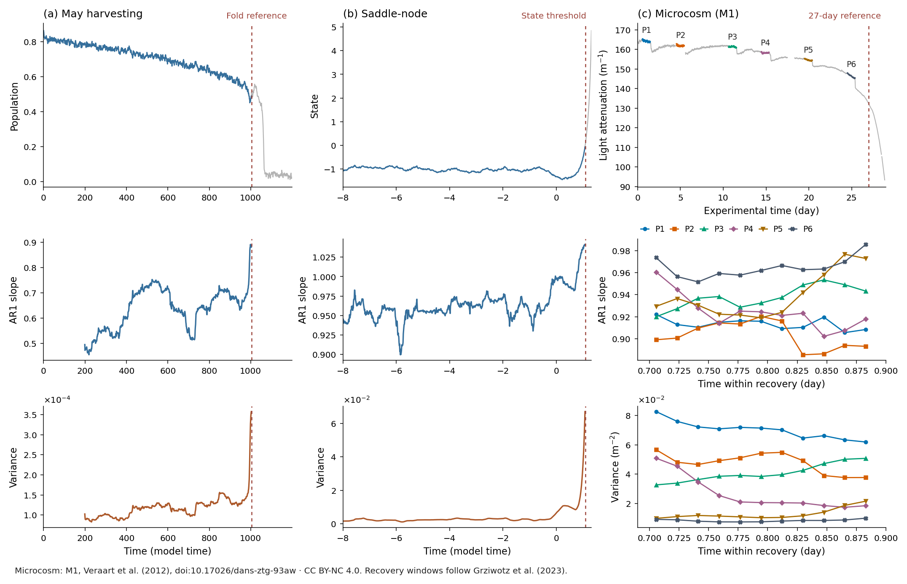
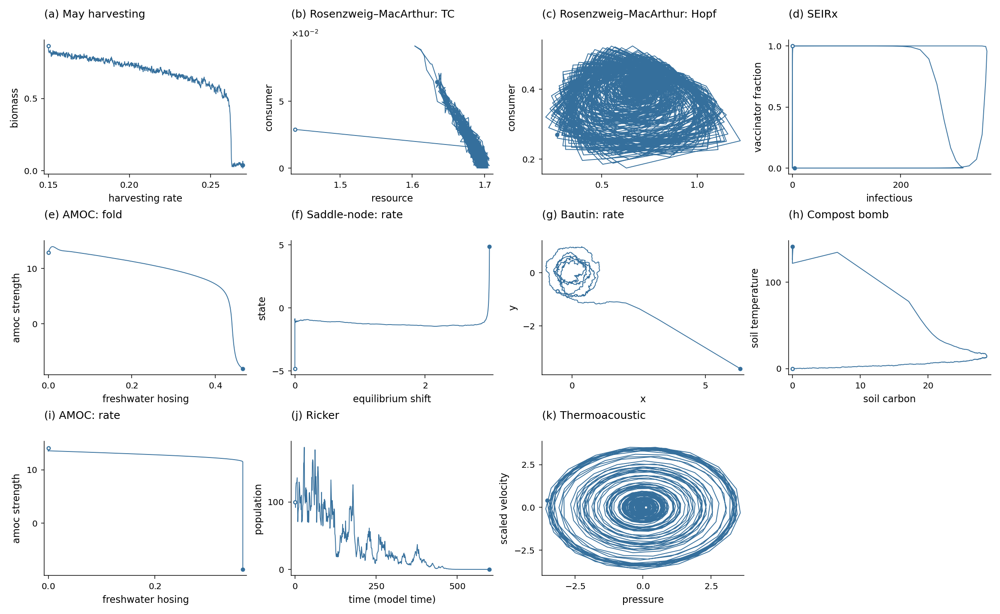

# TipBox

Named stochastic box models, empirical time series, and classical early-warning benchmarks. JAX integration kernels; no AUTO dependency. The model interface and gallery follow [dysts](https://github.com/GilpinLab/dysts).

## Install

```bash
git clone https://github.com/juannat7/tipbox.git
cd tipbox
pip install -e .
```

Requires Python 3.10 or newer.

## Simulate

```python
from tipbox.models import MayHarvesting

model = MayHarvesting(r=1, k=1, s=0.1)
result = model.make_trajectory(1000, noise=1, seed=42)
print(result.time.shape, result.trajectory.shape)  # (1000,) (1000, 1)
```

Coefficients, initial states, forcing, noise, integration steps, and sampling are configurable. Each [model reference](docs/models/index.rst) gives the equation, defaults, units, and event rule. `noise=1` uses May's configured diffusion amplitude 0.01; noise conventions differ by model.

## Evaluate indicators

```python
from tipbox.models import MayHarvesting
from tipbox.datasets import generate_dataset
from tipbox.indicators import rolling_ar1, rolling_variance
from tipbox.metrics import ensemble_roc, plot_roc

batch = generate_dataset(
    MayHarvesting(), num_timesteps=300, n_tipping=5, n_null=5,
    n=1000, noise=1, lead_steps=1, seed=42,
)
signals = batch.observations[:, :, 0]  # (10, 300)
indicators = {
    "AR1": [rolling_ar1(x, window=100, detrend="linear") for x in signals],
    "Variance": [rolling_variance(x, window=100, detrend="linear") for x in signals],
}
report = ensemble_roc(batch.labels, indicators)
print(report.curves["Variance"].auroc)
ax = plot_roc(report)
```

Each trajectory contributes one Kendall trend score. Larger scores mean tipping; directions are fixed before evaluation. Results include missing-score and class counts. These [outcome-conditioned batches](docs/benchmarks.rst) do not estimate natural tipping probabilities or universal detection performance.



Simulated indicators end before their fold or state-threshold reference. Microcosm recoveries are analyzed separately. Data: Veraart et al. (2012), [DANS](https://doi.org/10.17026/dans-ztg-93aw), CC BY-NC 4.0; intervals follow Grziwotz et al. (2023). [Settings and reproduction](docs/figures.rst) · [Figure license](docs/_static/figures/LICENSE.md).

## Load observations

```python
from tipbox.datasets import load_microcosm_original

record = load_microcosm_original()
print(record.observations.shape)  # (7914, 2): M1, M2
```

`load_empirical(name)` also loads the five [KEWS](https://github.com/juannat7/kews) cases: `microcosm`, `voice`, `mitochondria`, `climate`, and `blackout`. Downloads are cached; original times and missing readings are preserved. See [sources and offline controls](docs/datasets.rst). Daphnia/TAC [simulation components](docs/sim_to_real.rst) are included; original observation import and fitted calibration remain pending.

## Models

| Model | Registry name | Mechanism | Reference |
|---|---|---|---|
| `MayHarvesting` | `b_harvesting` | Fold | May 1977 |
| `RosenzweigMacArthur(bifurcation_type="transcritical")` | `b_rosenzweig_macarthur_tc` | Transcritical | Bury et al. 2021 |
| `RosenzweigMacArthur(bifurcation_type="hopf")` | `b_rosenzweig_macarthur_hopf` | Hopf | Bury et al. 2021 |
| `SEIRx` | `b_seirx_tc` | Transcritical | Bury et al. 2021 |
| `AMOC` | `b_amoc` | Fold | Alkhayuon et al. 2019; Ritchie et al. 2023 |
| `Ricker` | `b_ricker` | Transcritical population map | Ricker 1954 |
| `Thermoacoustic` | `b_thermoacoustic` | Subcritical Hopf | Bonciolini et al. 2018 |
| `SaddleNode` | `r_saddle_node` | Rate-induced | Ashwin et al. 2012 |
| `Bautin` | `r_bautin` | Rate-induced | Ritchie et al. 2023 |
| `CompostBomb` | `r_compost_bomb` | Rate-induced | Wieczorek et al. 2011 |
| `AMOCRate` | `r_amoc` | Rate-induced | Alkhayuon et al. 2019; Ritchie et al. 2023 |



Open/filled dots mark displayed start/end. The [manifest and figure guide](docs/figures.rst) record coefficients, seeds, grids, and display limits. Model equations follow the cited sources; forcing, initialization, and null protocols can differ. These differences are stated on the model pages.

## Documentation

[Quickstart](docs/quickstart.rst) · [Model controls](docs/usage.rst) · [API](docs/api.rst) · [Indicators](docs/indicators.rst) · [Compatibility](docs/compatibility.rst) · [AI index](docs/llms.txt)

```bash
pip install -e ".[docs]"
python -m sphinx -b html docs docs/_build/html
JAX_PLATFORMS=cpu python examples/figures.py
```

Runnable notebooks: [generation and evaluation](notebook/01_generate_batch.ipynb), [parameter sensitivity](notebook/02_sensitivity_analysis.ipynb).

## Used in research

- Nathaniel et al. (2026), [Koopman early warning signals for bifurcation and rate-induced tipping](https://arxiv.org/abs/2608.14716), with [KEWS code](https://github.com/juannat7/kews).
- Sevinchan et al. (2026), [In-context learning to predict critical transitions in dynamical systems](https://arxiv.org/abs/2605.12308).

Both used earlier TipBox versions; see the compatibility reference for numerical changes.
