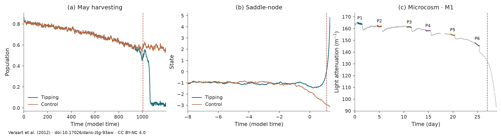
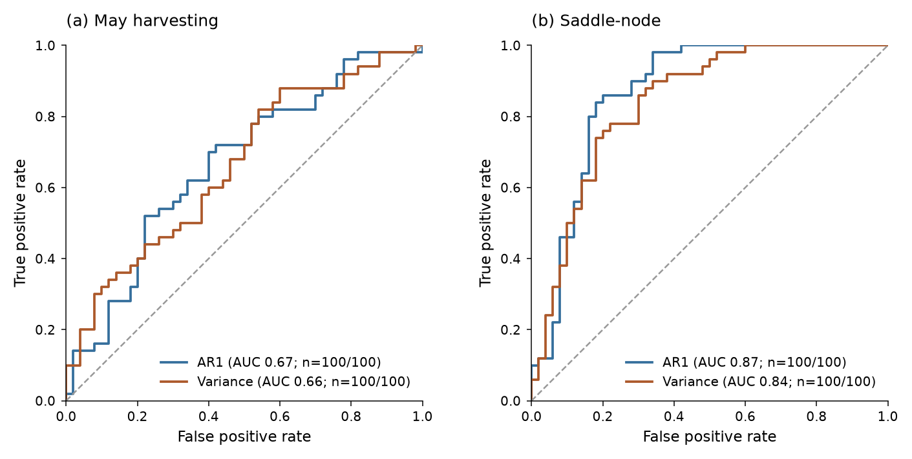

#  TipBox

TipBox is a collection of tipping models and empirical observations. It covers bifurcation- and rate-induced tipping in stochastic systems, with early-warning indicators such as lag-1 autocorrelation and variance.

<div align="center">

[](https://www.python.org/) [](https://juannat7.github.io/tipbox/) [](LICENSE)

</div>

## Contents

- [Installation](#installation)
- [Generate or load a time series](#generate-or-load-a-time-series)
- [Early-warning indicators](#compute-early-warning-indicators)
- [Benchmarking](#benchmarking)
- [Systems](#systems)
- [Notebook examples](#notebook-examples)
- [Used in research](#used-in-research)
- [Citation](#citation)

## Installation

```bash
git clone https://github.com/juannat7/tipbox.git
cd tipbox
pip install -e .
```

## Generate or load a time series

TipBox provides a common interface to simulate tipping systems and load observations. See the [system collection](#systems) for available models and their documentation.

```python
from tipbox.models import MayHarvesting, SaddleNode
from tipbox.datasets import Microcosm

# Bifurcation-induced tipping
harvesting = MayHarvesting()
bifurcation = harvesting.make_trajectory(num_samples=1200, noise=1.0, seed=43)
bifurcation_control = harvesting.make_trajectory(num_samples=1200, noise=1.0, seed=43, null_simulation=True)

# Rate-induced tipping
rate_model = SaddleNode(epsilon=1.4)
rate = rate_model.make_trajectory(num_samples=2401, noise=0.01, seed=43)
rate_control = rate_model.make_trajectory(num_samples=2401, noise=0.01, seed=43, null_simulation=True)

# Empirical observations: Veraart et al. (2012), chemostats M1 and M2.
observed = Microcosm().load()
```

Simulation results contain `time` and `trajectory` arrays; loaded observations contain `time` and `observations`. Equations, parameters, and simulation controls are in the [documentation](https://juannat7.github.io/tipbox/usage.html).



Empirical panels: [CC BY-NC 4.0](docs/_static/figures/LICENSE.md).

## Compute early-warning indicators

Choose an observable and apply a trailing-window statistic before the fold:

```python
from tipbox.indicators import rolling_ar1, rolling_variance

before_fold = bifurcation.param_values < harvesting.critical_parameter
signal = bifurcation.trajectory[before_fold, 0]

# Get early warning signals
ar1 = rolling_ar1(signal, window=200, detrend="linear")
variance = rolling_variance(signal, window=200, detrend="linear")
```

The [indicator reference](https://juannat7.github.io/tipbox/indicators.html) also covers autocorrelation, skewness, and kurtosis.


## Benchmarking

Evaluate indicator trends on tipping and control trajectories with the area under the ROC curve (AUROC). Each trajectory contributes one score.

### Generate a batch

Batches support repeated experiments and indicator comparisons:

```python
from tipbox.models import MayHarvesting
from tipbox.datasets import generate_dataset
from tipbox.indicators import rolling_ar1, rolling_variance
from tipbox.metrics import ensemble_roc, plot_roc

# 50 tipping trajectories + 50 controls; retain 300 samples before each tipping threshold.
batch = generate_dataset(
    MayHarvesting(), num_tipping=50, num_controls=50, num_samples=1000,
    context_samples=300, noise=1.0, seed=43,
)
signals = batch.observations[:, :, 0]  # First observed variable in each trajectory.
indicators = {
    "AR1": [rolling_ar1(x, window=100, detrend="linear") for x in signals],
    "Variance": [rolling_variance(x, window=100, detrend="linear") for x in signals],
}
```

Score the indicator trend in each trajectory and plot the ROC curves:

```python
report = ensemble_roc(batch.labels, indicators)  # Labels: 0 control, 1 tipping.
ax = plot_roc(report)
```



See the [benchmark guide](https://juannat7.github.io/tipbox/benchmarks.html) for labels, trend scores, and evaluation conventions.

## Systems

Import model classes from `tipbox.models` and observation classes from `tipbox.datasets`.
Model links include equations and defaults; observation links describe `.load()`.

| System | Class / call | Mechanism / observable |
|---|---|---|
| **Models** | | |
| [May harvesting](https://juannat7.github.io/tipbox/models/harvesting.html) | `MayHarvesting` | Fold |
| [Rosenzweig–MacArthur](https://juannat7.github.io/tipbox/models/consumer_resource.html) | `RosenzweigMacArthur` | Transcritical / Hopf |
| [Disease and vaccination](https://juannat7.github.io/tipbox/models/seirx.html) | `SEIRx` | Transcritical |
| [Ocean overturning](https://juannat7.github.io/tipbox/models/amoc.html#amoc-fold) | `AMOCFold` | Fold |
| [Moving saddle-node](https://juannat7.github.io/tipbox/models/saddle_node.html) | `SaddleNode` | Rate-induced |
| [Moving Bautin](https://juannat7.github.io/tipbox/models/bautin.html) | `Bautin` | Rate-induced |
| [Compost bomb](https://juannat7.github.io/tipbox/models/compost.html) | `CompostBomb` | Rate-induced |
| [Ocean overturning](https://juannat7.github.io/tipbox/models/amoc.html#amoc-rate) | `AMOCRate` | Rate-induced |
| [Ricker population map](https://juannat7.github.io/tipbox/models/ricker.html) | `Ricker` | Population decline |
| [Combustion oscillator](https://juannat7.github.io/tipbox/models/thermoacoustic.html) | `Thermoacoustic` | Subcritical Hopf |
| **Empirical observations** | | |
| [Microcosm · M1 and M2](https://juannat7.github.io/tipbox/api.html#tipbox.datasets.Microcosm) | `Microcosm().load()` | Light attenuation |
| [Voice onset](https://juannat7.github.io/tipbox/api.html#tipbox.datasets.VoiceOnset) | `VoiceOnset().load()` | Subglottal pressure |
| [Cellular ATP](https://juannat7.github.io/tipbox/api.html#tipbox.datasets.CellularATP) | `CellularATP().load()` | Fluorescence ratio |
| [Paleoclimate](https://juannat7.github.io/tipbox/api.html#tipbox.datasets.Paleoclimate) | `Paleoclimate().load()` | CaCO₃ |
| [Electrical blackout](https://juannat7.github.io/tipbox/api.html#tipbox.datasets.ElectricalBlackout) | `ElectricalBlackout().load()` | Frequency |

Full reference: [system catalog](https://juannat7.github.io/tipbox/models/index.html).


## Notebook examples

- [Generation and evaluation](notebook/01_generate_batch.ipynb)
- [Parameter sensitivity](notebook/02_sensitivity_analysis.ipynb)

## Used in research

- **[In revision]** Nathaniel et al. (2026), [Koopman early warning signals for bifurcation and rate-induced tipping](https://arxiv.org/abs/2608.14716). Code: [KEWS](https://github.com/juannat7/kews).
- **[NeurIPS 2026]** Sevinchan, Nathaniel, et al. (2026), [In-context learning to predict critical transitions in dynamical systems](https://arxiv.org/abs/2605.12308).

## Citation

If you use TipBox's code or datasets, we would appreciate citations to these works:

```bibtex
@article{nathaniel2026koopman,
  title={Koopman early warning signals for bifurcation and rate-induced tipping},
  author={Nathaniel, Juan and Roesch, Carla and DeSantis, Derek and Kooloth, Parvathi and Fan, Hang and Lucarini, Valerio and Romanou, Anastasia and Gentine, Pierre},
  journal={arXiv preprint arXiv:2608.14716},
  year={2026}
}

@article{sevinchan2026context,
  title={In-context learning to predict critical transitions in dynamical systems},
  author={Sevinchan, Yunus and Nathaniel, Juan and Ueltzh{\"o}ffer, Kai and Roesch, Carla and Weber, Tobias and Laschos, Vaios and Fan, Hang and Ramien, Gregor and Haux, Johannes and Gentine, Pierre and others},
  journal={arXiv preprint arXiv:2605.12308},
  year={2026}
}
```
