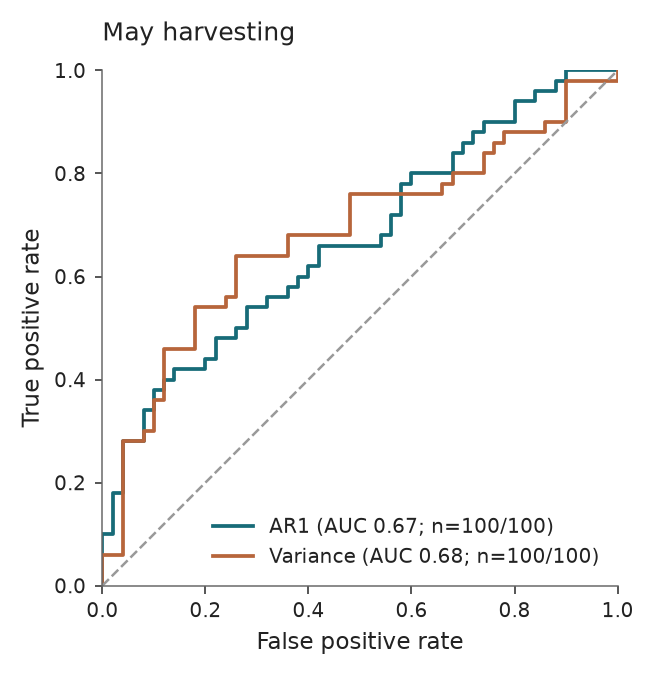

Benchmarking
============

Generate tipping and control trajectories, compute indicator trends, and
compare them with the area under the ROC curve (AUROC):

Example
-------

.. code-block:: python

   from tipbox.models import MayHarvesting
   from tipbox.datasets import generate_dataset
   from tipbox.indicators import rolling_ar1, rolling_variance
   from tipbox.metrics import ensemble_roc, plot_roc

   # 50 tipping trajectories + 50 controls; retain 300 samples before each reference.
   batch = generate_dataset(
       MayHarvesting(), n_tipping=50, n_null=50, n=1000,
       num_timesteps=300, noise=1.0, seed=43,
   )
   signals = batch.observations[:, :, 0]
   indicators = {
       "AR1": [rolling_ar1(x, window=100, detrend="linear") for x in signals],
       "Variance": [rolling_variance(x, window=100, detrend="linear") for x in signals],
   }
   report = ensemble_roc(batch.labels, indicators)  # Labels: 0 control, 1 tipping.
   print(report.curves["Variance"].auroc)
   ax = plot_roc(report)

``n`` controls the full simulation; ``num_timesteps`` retains 300 observations
before each reference. Each trajectory contributes one Kendall trend score.
Higher scores indicate tipping.

See the :ref:`API reference <benchmark-api>` for generation options, event definitions,
and missing-score counts.
