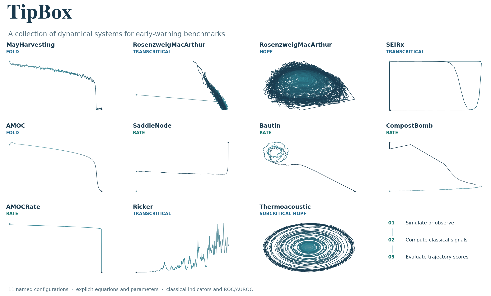
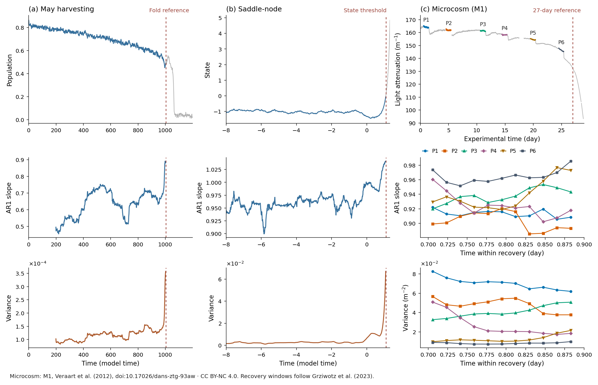
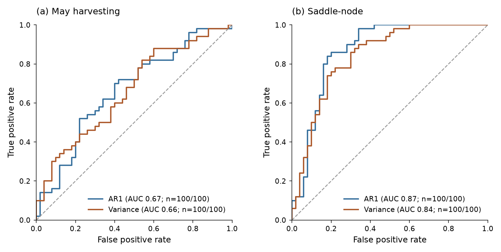

Reproducing the figures
=======================

The overview follows the trajectory-gallery approach of
`dysts <https://github.com/GilpinLab/dysts>`_. Every curve comes from an actual
TipBox simulation. The figure source is ``examples/figures.py``; the adjacent
``_static/figures/manifest.json`` records numerical controls, source checksums,
software versions, and display transformations.

Cards use public model names, so a displayed name maps directly to an import
from ``tipbox.models``. Each gallery curve is the first accepted tipping
trajectory from root seed 42 with 300 pre-reference samples available. Selection
uses the model's declared outcome convention; a forcing crossing need not be
an observed state jump. Accepted seeds and rejection attempts are in the manifest.

The gallery uses physical observable pairs or forcing against an observable.
Each coordinate is independently normalized for display; geometry is not a
comparison of physical magnitudes across systems. Light-to-dark color follows
simulation time, with dots at the displayed endpoints. The saddle-node display
excludes escaped states with absolute value above five; the Bautin display
ends at the configured radius threshold of ten, and compost temperature
is shown up to 150 model temperature units. Nonfinite points are omitted.

Signals and classical indicators
---------------------------------

The first two columns show the first accepted tipping trajectory from a
declared root seed, using :func:`~tipbox.datasets.benchmarks.generate_dataset` for
selection. Indicators use 200-sample trailing windows, step one, and linear
detrending fitted independently within each window. Inputs end strictly
before the model's reference marker. Gray signal portions provide later
context; they do not enter the indicators. Harvesting uses ``n=1200`` and
``noise=1``; the moving-equilibrium model uses its configured time interval
and ``noise=0.01``. Their noise parameters have different meanings, described
in the individual :doc:`model references <models/index>`.

The empirical column uses M1 from the :ref:`original microcosm deposit
<original-microcosm-source>`. The upper panel shows experimental time and
six separate recovery intervals, with the published 27-day reference. Lower
panels show each recovery against its own elapsed time. Indicators use 200
samples, step five, and per-window linear detrending; intervals are never
concatenated. These illustrative calculations use TipBox's classical
definitions, rather than reproducing the original paper's analysis.
P1–P6 labels on the raw record map to distinct colors and marker shapes below;
the legend sits outside the indicator data. Red dashed references are labeled
by their case-specific meaning.

The empirical figure is available under CC BY-NC 4.0, with attribution to
Veraart et al. (2012), data DOI:10.17026/dans-ztg-93aw. Interval annotations
follow Grziwotz et al. (2023), DOI:10.1126/sciadv.abq4558. See the
``_static/figures/LICENSE.md`` notice. Original data are downloaded to a user
cache and are not bundled with the figures.

Ensemble evaluation
--------------------

Each model supplies 50 tipping and 50 null trajectories. The retained
300-sample contexts end one observation before their reference markers.
AR1 and variance use 100-sample trailing, linearly detrended windows, with
Kendall tau-b as the trajectory score. An increasing score direction is
declared for both indicators. Seed 42, windows, and noise controls are fixed
in the script; they are not selected to improve AUROC. Coverage counts
accompany every curve.

The harvesting simulation uses ``n=1000, noise=1``; the moving-equilibrium
simulation uses its configured time interval and ``noise=0.01``. Batches are
conditioned on each model's tipping outcome. Equal context counts do not
match physical duration, forcing history, or event definitions. These are
descriptive API examples, not estimates of general predictive performance.
See :doc:`benchmarks` for labels, rejection sampling, and lead conventions.

Commands and exports
---------------------

From the repository root:

.. code-block:: bash

   pip install -e .
   JAX_PLATFORMS=cpu python examples/figures.py

The default output is ``docs/_static/figures``. The first run downloads the
original microcosm ODS into the TipBox cache. For a local source or a different
output directory:

.. code-block:: bash

   JAX_PLATFORMS=cpu python examples/figures.py \
       --source-path "/path/to/Correct data both chemostats.ods" \
       --output-dir /path/to/figures

Controls are ``--seed 42``, ``--n-per-class 50``, ``--cache-dir PATH``,
``--source-path PATH``, ``--output-dir PATH``, and
``--formats png svg pdf``. PNG, vector SVG, and PDF are generated together
by default. The manifest includes exact coefficients, accepted seeds,
rejection attempts, physical lead ranges, analysis windows, displayed row
slices, software versions, and hashes of the script and package Python
sources, JAX backend, and JAX 64-bit mode. Numerical and rendering details may
differ across library versions or JAX backends; the manifest describes the
checked reference environment.

Downloads: :download:`overview SVG <_static/figures/overview.svg>`,
:download:`overview PDF <_static/figures/overview.pdf>`,
:download:`indicators PDF <_static/figures/indicators.pdf>`,
:download:`ROC PDF <_static/figures/roc.pdf>`,
:download:`manifest <_static/figures/manifest.json>`.
