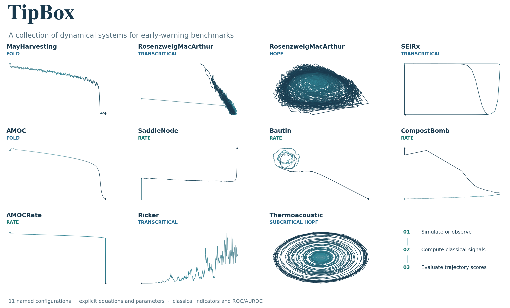

Box models for tipping-point benchmarks
=======================================

.. container:: tipbox-lead

   Generate a time series. Measure its warning signals. Evaluate one score per
   trajectory against an explicit reference event.

TipBox collects named stochastic box models and empirical observations for
studying critical transitions. It provides classical indicators and ROC/AUROC,
with inspectable parameters, local random seeds, and source provenance.

.. container:: tipbox-paths

   .. container:: tipbox-path

      :doc:`Start with a working example <quickstart>`

      Simulate, compute an indicator, and evaluate a small labeled batch.

   .. container:: tipbox-path

      :doc:`Choose a model <models/index>`

      Read its equation, observable names, parameter defaults, and event rule.

   .. container:: tipbox-path

      :doc:`Find an API <api>`

      Check imports, input shapes, returned objects, and failure conventions.

A model in three lines
----------------------

.. code-block:: python

   from tipbox.models import MayHarvesting

   result = MayHarvesting().make_trajectory(1000, noise=1.0, seed=42)
   print(result.time.shape, result.trajectory.shape)  # (1000,) (1000, 1)

Install Python 3.10 or newer, clone the repository, and run ``pip install -e .``.
The :doc:`quickstart` includes complete installation and analysis examples.
Continuous-time integration kernels use JAX; the indicator functions accept
concrete NumPy or JAX arrays and return NumPy arrays.

Explore the collection
----------------------

The compact named-model API and trajectory gallery take inspiration from
`dysts <https://github.com/GilpinLab/dysts>`_. Each model keeps its own physical
clock, noise convention, and reference event. See :doc:`models/index` for the
collection and :doc:`figures` for reproducible figure controls.

.. toctree::
   :hidden:
   :caption: Learn

   quickstart
   usage

.. toctree::
   :hidden:
   :caption: Reference

   models/index
   indicators
   benchmarks
   datasets
   api

.. toctree::
   :hidden:
   :caption: Research and reproduction

   sim_to_real
   figures
   compatibility

Research using TipBox
---------------------

* Nathaniel et al., `Koopman early warning signals for bifurcation and rate-induced
  tipping <https://arxiv.org/abs/2608.14716>`_ (2026), with the
  `KEWS implementation <https://github.com/juannat7/kews>`_.
* Sevinchan et al., `In-context learning to predict critical transitions in
  dynamical systems <https://arxiv.org/abs/2605.12308>`_ (2026).

These studies used earlier versions. :doc:`compatibility` records numerical
corrections and historical settings. A `plain-text documentation index
<llms.txt>`_ provides a compact entry point for coding assistants.
