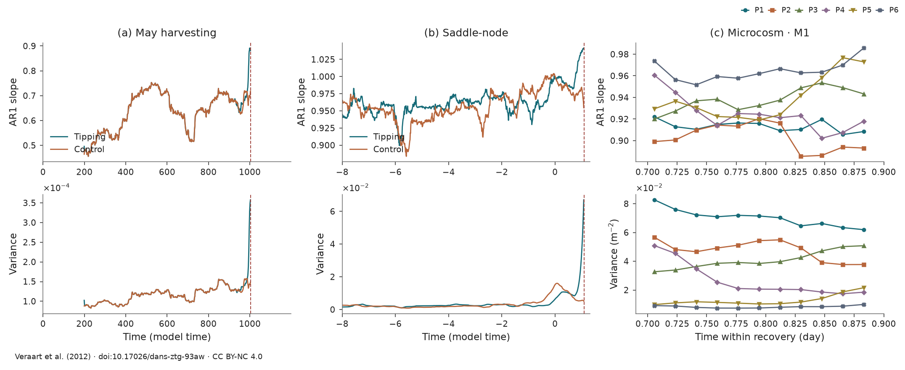

Early-warning indicators
========================

.. list-table::
   :header-rows: 1
   :widths: 42 58
   :class: catalog-table

   * - Function
     - Measures
   * - :func:`~tipbox.indicators.rolling_ar1`
     - Lagged regression slope
   * - :func:`~tipbox.indicators.rolling_acf`
     - Lagged Pearson correlation
   * - :func:`~tipbox.indicators.rolling_variance`
     - Variance
   * - :func:`~tipbox.indicators.rolling_skewness`
     - Asymmetry
   * - :func:`~tipbox.indicators.rolling_kurtosis`
     - Tail weight

Example
-------

Continuing the :doc:`quickstart`:

.. code-block:: python

   from tipbox.indicators import rolling_variance

   variance = rolling_variance(
       signal,
       window=200,
       detrend="linear",
   )

See the :ref:`API reference <indicator-api>` for window options, defaults, and definitions.
Figure settings and data credits are in :doc:`figures`.
