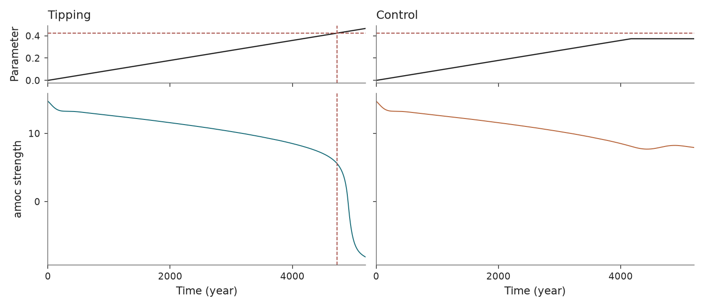
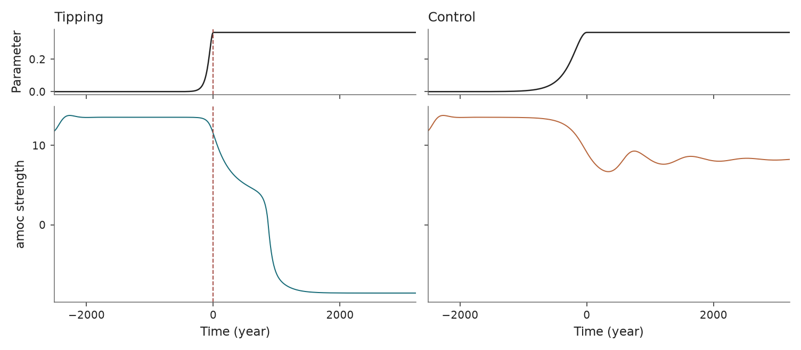

Atlantic meridional overturning circulation
===========================================

``b_amoc`` and ``r_amoc`` · ``tipbox.models.AMOCFold`` and ``AMOCRate``

.. _amoc-fold:

AMOCFold
--------

.. code-block:: python

   from tipbox.models import AMOCFold

   model = AMOCFold()
   result = model.make_trajectory(num_samples=1041, noise=0.01, seed=43)
   transport = result.trajectory[:, 0]

   control = model.make_trajectory(num_samples=1041, noise=0.01, seed=43, null_simulation=True)

   Overturning strength under increasing freshwater input. Dashed lines mark the calibrated fold.

.. _amoc-rate:

AMOCRate
--------

.. code-block:: python

   from tipbox.models import AMOCRate

   model = AMOCRate()
   result = model.make_trajectory(num_samples=1142, noise=0.01, seed=43)
   transport = result.trajectory[:, 0]

   control = model.make_trajectory(num_samples=1142, noise=0.01, seed=43, null_simulation=True)

   Overturning strength for rapid and slow hosing. The dashed line marks the start of the hosing plateau.

Equations and forcing
---------------------

Both scenarios use the same two-state reduction of a five-box ocean model.
The physical coordinates :math:`z_N,z_T` are scaled salinity anomalies:
:math:`S_N=S_0+z_N/100` and :math:`S_T=S_0+z_T/100`. Absolute salinity in psu is
:math:`1000S_0+10z`. Negative anomaly coordinates are physically permitted.

Transport and salt conservation
-------------------------------

Write :math:`n=z_N/100`, :math:`u=z_T/100`, :math:`s=S_S-S_0`, and
:math:`b=S_B-S_0`. The Indo-Pacific anomaly follows from conserved total salt:

.. math::

   i=\frac{C-S_0\sum_j V_j-V_Nn-V_Tu-V_Ss-V_Bb}{V_{IP}}.

Transport :math:`q` in cubic metres per second and the observed strength
:math:`Q` in Sverdrups are

.. math::

   q=\frac{\lambda_q[\alpha(T_S-T_0)+\beta(n-s)]}
           {1+\lambda_q\alpha\mu},\qquad Q=10^{-6}q.

The freshwater transports use the hosing control :math:`H`:

.. math::

   F_N(H)=10^6(F_{N0}+F_{NH}H),\qquad
   F_T(H)=10^6(F_{T0}+F_{TH}H).

Define the advective terms

.. math::

   A_N&=\begin{cases}q(u-n),&q\ge0,\\|q|(b-n),&q<0,\end{cases}\\
   A_T&=\begin{cases}q[\gamma s+(1-\gamma)i-u],&q\ge0,\\|q|(n-u),&q<0.\end{cases}

Then the implemented stochastic salt balance is

.. math::

   dz_N&=\frac{100Y}{V_N}[A_N+K_N(u-n)-F_NS_0]dt
          +\eta\sigma_{SN}\,dW_N,\\
   dz_T&=\frac{100Y}{V_T}[A_T+K_S(s-u)+K_N(n-u)-F_TS_0]dt
          +\eta\sigma_{ST}\,dW_T.

Here :math:`Y` is ``physics.seconds_per_year``; time is measured in years.
The factor of 100 converts mass fractions to the scaled anomaly coordinates.

Bifurcation scenario
--------------------

The forcing ramps relative to the simulation's start time:

.. math::

   H(t)=\min\left[H_0+
      \frac{H_{\rm fold}-H_0}{T/\text{param_end_multiplier}}(t-t_0),
      H_{\rm cap}\right].

The cap is :math:`H_{\rm fold}+\delta_{\rm cap}` for forced runs and
:math:`H_{\rm fold}-\delta_{\rm cap}` for null runs. The configured fold is a
calibrated marker. It is not automatically valid after changing physical
coefficients.

.. model-parameters:: b_amoc

Rate-induced scenario
---------------------

The forcing is a smooth ramp followed by a plateau:

.. math::

   H(t)=\begin{cases}
       H_0+\Delta H/\cosh(rt),&t<0,\\
       H_0+\Delta H,&t\ge0.
   \end{cases}

Forced and null runs use ``r_fast`` and ``r_slow`` respectively. This schedule
uses absolute time, with its plateau beginning at zero. The simulator
checks for transport below ``Q_collapse_threshold`` and uses the forcing's
zero-time point as its extraction marker. The marker and actual collapse time
are distinct quantities.

.. model-parameters:: r_amoc

Numerical and observation conventions
-------------------------------------

Both models integrate drift using RK4 with true midpoint forcing values in the
new interface, then add independent Gaussian salinity increments. No positivity
projection is applied to salinity anomalies. ``make_trajectory`` samples its
initial state from the configured Gaussian mean and ``sigma_ic``; explicit
``initial_state`` overrides that distribution.

Observed columns are :math:`(Q,z_N,z_T)`. All physical constants are exposed
through the shared immutable ``AMOCPhysics`` configuration, for example:

.. code-block:: python

   from tipbox.models import AMOCFold, AMOCPhysics

   model = AMOCFold(physics=AMOCPhysics(K_N=1.8e6), sigma_ic=0)
   result = model.make_trajectory(num_samples=1000, noise=0.0, seed=43)

References: `Alkhayuon et al. (2019)
<https://doi.org/10.1098/rspa.2019.0051>`_ and Appendix A4 of
`Ritchie et al. (2023) <https://doi.org/10.5194/esd-14-669-2023>`_. The original
`MATLAB salt-balance implementation
<https://github.com/hassanalkhayuon/rtippingreview/blob/main/BoxModel_2DH_IVP.m>`_
and `plotting driver
<https://github.com/hassanalkhayuon/rtippingreview/blob/main/tipping_movie_AMOC.m>`_
provide the code provenance and year convention.
