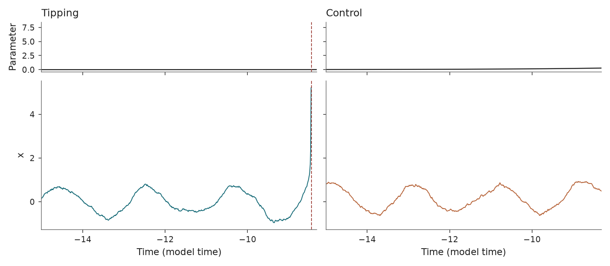

Rate-induced Bautin normal form
===============================

``r_bautin`` · ``tipbox.models.Bautin``

Usage
-----

.. code-block:: python

   from tipbox.models import Bautin

   model = Bautin()
   result = model.make_trajectory(num_samples=3001, noise=0.01, seed=45)  # Selected tipping realization.
   x, y = result.trajectory.T

   control = model.make_trajectory(num_samples=3001, noise=0.01, seed=43, null_simulation=True)

   Selected stochastic escape and control; the escape precedes the main forcing change.
   The dashed line marks the first radius-threshold crossing.

Equations and forcing
---------------------

Let :math:`Z=X+iY` and :math:`w=Z-\Lambda(t)`. The implemented Cartesian dynamics
are equivalent to

.. math::

   dZ=\left[(a+i\omega)w-b|w|^2w+|w|^4w\right]dt
       +D_2\eta(dW_X+i\,dW_Y),

with translating equilibrium

.. math::

   \Lambda(t)=\frac{\Lambda_{\max}}2
       \left[\tanh\left(\frac{\Lambda_{\max}rt}{2}\right)+1\right].

The radial factors are :math:`|w|^2` and :math:`|w|^4`, not complex powers of
:math:`w`. The null schedule multiplies ``r`` by ``null_rate_factor``. Each
initial Cartesian coordinate is sampled independently from the configured
uniform interval. The event marker is the first time
:math:`\sqrt{X^2+Y^2}` exceeds ``tip_threshold``, measured about the origin.

Euler–Maruyama uses independent noises in both coordinates. The polynomial
normal form can diverge after departure; long full trajectories may become
nonfinite. Benchmark contexts must be checked before calculating indicators.

Parameters and defaults
-----------------------

.. model-parameters:: r_bautin

Reference context: `Ritchie et al. (2023)
<https://doi.org/10.5194/esd-14-669-2023>`_. The implementation retains the
repository's stochastic Bautin parameterization and event convention.
The stochastic numerical example follows
`Huang et al. (2024) <https://doi.org/10.1038/s42256-024-00937-0>`_;
TipBox's null-rate and noise-multiplier conventions are separate choices.
