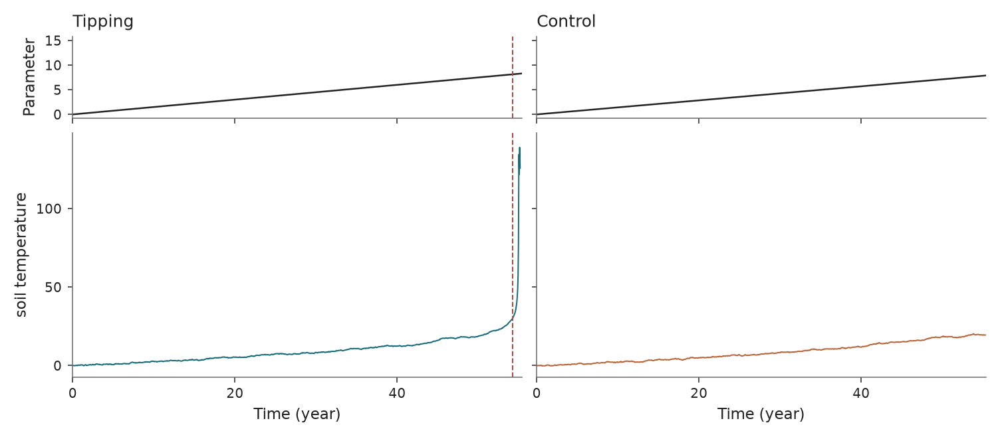

Compost-bomb instability
========================

``r_compost_bomb`` · ``tipbox.models.CompostBomb``

Usage
-----

.. code-block:: python

   from tipbox.models import CompostBomb

   model = CompostBomb()
   result = model.make_trajectory(n=2001, noise=0.01, seed=45)  # Selected tipping realization.
   carbon, temperature = result.trajectory.T

   control = model.make_trajectory(n=2001, noise=0.01, seed=43, null_simulation=True)

   Soil temperature for tipping and control. The dashed line marks the threshold-crossing time.

Equations and forcing
---------------------

Soil carbon :math:`C` and soil temperature :math:`T` follow

.. math::

   dC &= [\Pi-C\rho(T)]dt,\\
   dT &= \frac{AC\rho(T)-\lambda(T-T_a(t))}{\mu}dt
          +D_3\eta\,dW_t,\\
   \rho(T)&=r_0\exp[\alpha(T-T_{\rm ref})],\qquad T_a(t)=vt.

Time is in years and temperatures are in degrees Celsius. The null schedule
multiplies ``v`` by ``null_rate_factor``. The integration updates carbon first,
projects it to nonnegative values, and uses the updated carbon in the same
step's temperature drift. Noise acts directly on temperature after division of
the deterministic heat balance by :math:`\mu`.

Initial carbon and temperature are independently sampled from the configured
uniform interval; its default zero-width interval sets both to zero. The
transition marker is the first soil-temperature crossing of ``tip_threshold``.

Parameters and defaults
-----------------------

.. model-parameters:: r_compost_bomb

References: `Luke and Cox (2011)
<https://doi.org/10.1111/j.1365-2389.2010.01312.x>`_ and
`Wieczorek et al. (2011) <https://doi.org/10.1098/rspa.2010.0485>`_.
