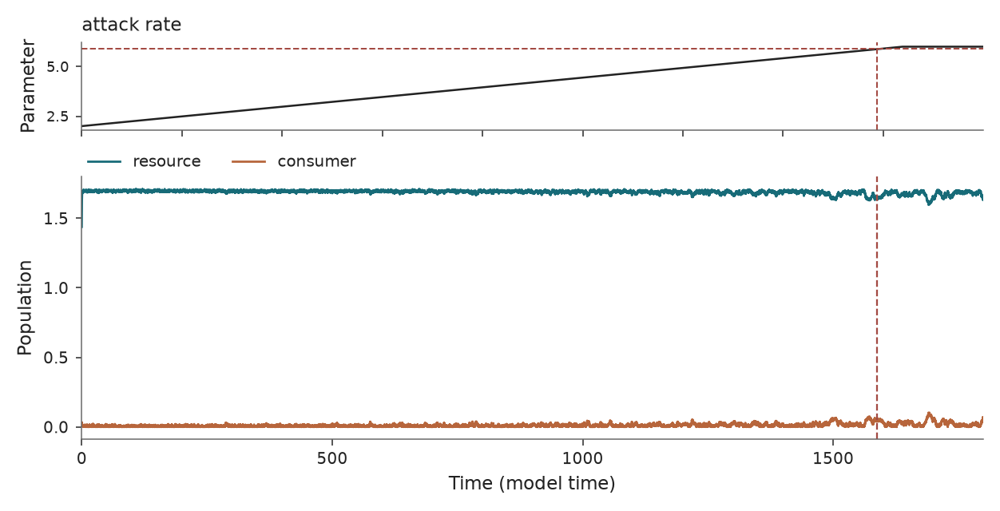
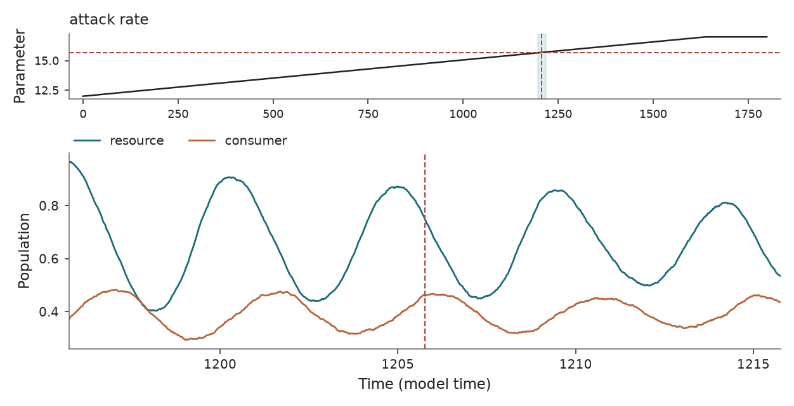

Rosenzweig–MacArthur consumer-resource model
============================================

``b_rosenzweig_macarthur_tc`` and ``b_rosenzweig_macarthur_hopf`` ·
``tipbox.models.RosenzweigMacArthur``

Usage
-----

.. code-block:: python

   from tipbox.models import RosenzweigMacArthur

   model = RosenzweigMacArthur(bifurcation_type="transcritical")
   result = model.make_trajectory(
       n=89951, dt_sample=0.02, noise=1.0, seed=42,
   )
   resource, consumer = result.trajectory.T

   Resource and consumer populations. Dashed lines mark the transcritical threshold.

Select ``"hopf"`` for the oscillatory scenario:

.. code-block:: python

   model = RosenzweigMacArthur(bifurcation_type="hopf")
   result = model.make_trajectory(
       n=89951, dt_sample=0.02, noise=1.0, seed=42,
   )

   Resource and consumer over 20 time units around the Hopf threshold. The parameter strip shows the full schedule and shades the displayed interval.

``n`` counts sampled observations. See :doc:`../usage` for integration,
sampling, noise, and custom-forcing controls.

Equations and forcing
---------------------

Resource :math:`x` and consumer :math:`y` obey

.. math::

   dx &= \left[r x(1-x/k)-\frac{a(t)xy}{1+a(t)hx}\right]dt
          +\sigma_1\eta\,dW_1,\\
   dy &= \left[\frac{e a(t)xy}{1+a(t)hx}-my\right]dt
          +\sigma_2\eta\,dW_2.

The attack rate uses the selected mode's ``a_*_min`` and ``a_*_max``. It ramps
over :math:`T/\text{param_end_multiplier}` and stays at its endpoint. The null
cap defaults to :math:`\max(a_{\min},2a_c-a_{\max})`; ``a_*_null`` supplies an
explicit alternative cap. Initial populations are sampled near the applicable
initial equilibrium. Both population coordinates are projected to nonnegative
values after each Euler–Maruyama step.

For positive :math:`k,e,h,m` and :math:`e>mh`, the analytic thresholds are

.. math::

   a_{\rm TC}=\frac{m}{k(e-mh)},\qquad
   a_{\rm Hopf}=\frac{e+mh}{hk(e-mh)}.

These follow from the invasion eigenvalue and the coexistence-equilibrium
Jacobian trace. Explicit ``a_*_bifurcation`` values override them. Invalid
analytic regimes raise an error rather than reporting a spurious threshold.

TipBox uses capped null ramps and no burn-in. Bury et al. (2021) holds null
attack rates at 2 (transcritical) or 12 (Hopf), uses a 100-time-unit burn-in,
and ramps Hopf forcing to 16; TipBox's Hopf endpoint is 17. The equations match,
but the default simulation protocols differ.

Markers are continuous-system thresholds. At finite Euler–Maruyama step sizes,
numerical oscillation onset can shift; refine ``dt`` when studying a Hopf onset.

Parameters and defaults
-----------------------

Both modes share these constructor defaults. ``bifurcation_type`` selects the
``a_transcritical_*`` or ``a_hopf_*`` forcing fields and analytic threshold.

.. model-parameters:: b_rosenzweig_macarthur_tc

Reference: `Rosenzweig and MacArthur (1963)
<https://doi.org/10.1086/282272>`_; benchmark parameterization follows
`Bury et al. (2021) <https://doi.org/10.1073/pnas.2106140118>`_. See
:doc:`../compatibility` for corrected noise controls and historical markers.
