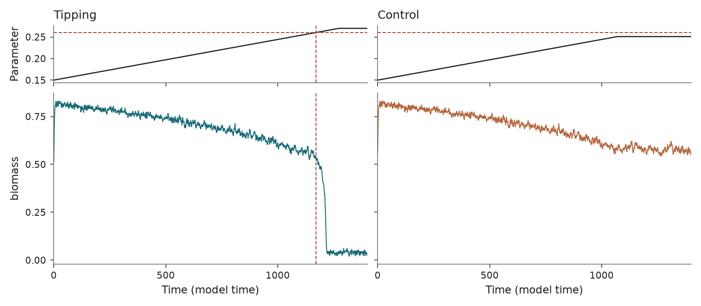

May harvesting
==============

``b_harvesting`` · ``tipbox.models.MayHarvesting``

Usage
-----

.. code-block:: python

   from tipbox.models import MayHarvesting

   model = MayHarvesting()
   result = model.make_trajectory(n=1400, noise=1.0, seed=43)
   biomass = result.trajectory[:, 0]

   control = model.make_trajectory(n=1400, noise=1.0, seed=43, null_simulation=True)

   Biomass under increasing harvesting. Dashed lines mark the upper fold.

Equations and forcing
---------------------

The biomass :math:`x` follows logistic growth with saturating harvesting:

.. math::

   dx = \left[r x\left(1-\frac{x}{k}\right)
        - h(t)\frac{x^2}{s^2+x^2}\right]dt
        + \sigma\eta\,dW_t.

Here :math:`\eta` is the ``noise`` argument. The initial harvesting rate is
``h_min``. Over duration :math:`T`, it ramps to ``h_max`` by
:math:`T/\text{param_end_multiplier}` and then stays constant. The null ramp is
capped at :math:`\max(h_{\min},2h_c-h_{\max})`.

For positive coefficients and :math:`s/k<1/\sqrt{27}`, the upper positive fold
satisfies :math:`f(x,h)=0` and :math:`\partial f/\partial x=0`:

.. math::

   x_c=\frac{k}{6}+\frac{k}{3}\cos\left[\frac13
       \arccos\left(1-54(s/k)^2\right)\right],\qquad
   h_c=r\left(1-\frac{x_c}{k}\right)\frac{s^2+x_c^2}{x_c}.

``critical_parameter`` computes this value unless ``h_bifurcation`` is explicitly
set. The automatic marker requires the upper-fold regime above.

Euler–Maruyama updates are projected to nonnegative biomass. Forced initial
states use the configured uniform interval; null initial states use the clipped
Gaussian controlled by ``null_initial_mean`` and ``null_initial_std``.

The drift and default coefficients follow Bury et al. (2021). TipBox uses a
capped null ramp and sampled initial states without burn-in; that paper uses
fixed null harvesting ``h=0.15`` and a 100-time-unit burn-in. These are different
benchmark protocols. Supply constant ``forcing`` and a separate warm-up when
reproducing that protocol.

Parameters and defaults
-----------------------

.. model-parameters:: b_harvesting

Reference: May (1977), `Thresholds and breakpoints in ecosystems with a
multiplicity of stable states <https://doi.org/10.1038/269471a0>`_; benchmark
formulation follows `Bury et al. (2021)
<https://doi.org/10.1073/pnas.2106140118>`_. The analytic expression above follows
from differentiating the implemented equilibrium curve.
