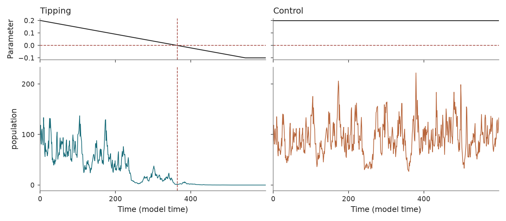

Stochastic Ricker population map
================================

``Ricker`` implements a density-dependent population map in log-population
coordinates, with a declining growth rate and illustrative default coefficients.

Usage
-----

.. code-block:: python

   from tipbox.models import Ricker

   model = Ricker()
   result = model.make_trajectory(n=600, noise=1.0, seed=43)
   population = result.trajectory[:, 0]

   control = model.make_trajectory(n=600, noise=1.0, seed=43, null_simulation=True)

   Population under declining log growth. Dashed lines mark zero log growth, not an observed extinction.

Equations and coordinates
-------------------------

With population :math:`N_k=\exp(z_k)>0`, density coefficient :math:`b>0`, and
independent standard-normal :math:`\xi_k`, each update is

.. math::

   z_{k+1} &= z_k+r_k-b\exp(z_k)+\sigma\,\eta\,\xi_k,\\
   N_{k+1} &= N_k\exp(r_k-bN_k+\sigma\,\eta\,\xi_k).

Here :math:`\eta` is the ``noise`` argument (shared default 0.01) and
:math:`\sigma` is the configured log-growth amplitude (default 0.2).
``noise=1`` therefore gives log-growth standard deviation 0.2 per update.
There is no :math:`\sqrt{dt}` factor: this is a discrete map. ``result.sigma``
is the per-update log-state scale :math:`\sigma\eta`.

The stored state and ``initial_state`` override are **log population**; the
observed column is population. Without an override, initialization uses
``log(config.initial_population)``. A zero initial population has no finite
log coordinate. No integer rounding, additive observation error, demographic
Poisson sampling, extinction threshold, or clipping is applied. Positive
populations approach zero continuously; a recorded zero caused by floating-point
underflow is not a modeled extinction event.

At constant deterministic :math:`r`, the positive equilibrium is
:math:`N^*=r/b` for :math:`r>0`. Its map multiplier is :math:`1-r`, so it is
locally stable for :math:`0<r<2`. The zero-population branch exchanges stability
at :math:`r=0`; larger positive growth rates can produce other Ricker dynamics.
This log-coordinate implementation follows the population dynamics for positive
states but cannot represent the zero branch as a finite state.

Time, forcing, and markers
--------------------------

``dt`` assigns a time interval to one map update. Changing it changes the
number of updates per unit time; it is not an ODE refinement setting.
``dt_sample`` defaults to the configuration's ``dt`` and may be an integer
multiple of the update spacing. Time is measured in model updates.

Forced log growth decreases linearly from ``r_start`` to ``r_end`` over the
simulated duration divided by ``param_end_multiplier`` (default 1.1), then
remains capped. Null forcing is constant ``r_null``. As for other normalized
ramps, changing ``n`` changes the forcing rate unless a custom callable is given.
The classifier tests whether growth reaches or falls below zero; the positive
reference is its first such sample. The null reference is the temporal midpoint.
These are growth/bifurcation references, not observed extinction times.

Parameters and defaults
-----------------------

.. model-parameters:: b_ricker

Reference
---------

Ricker (1954), *Stock and recruitment*,
`doi:10.1139/f54-039 <https://doi.org/10.1139/f54-039>`_. The noise model,
forcing protocol, and illustrative coefficients above are explicit TipBox
choices.
