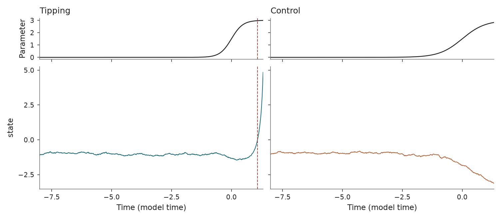

Rate-induced saddle-node normal form
====================================

``r_saddle_node`` · ``tipbox.models.SaddleNode``

Usage
-----

.. code-block:: python

   from tipbox.models import SaddleNode

   model = SaddleNode(epsilon=1.4)
   result = model.make_trajectory(
       n=2401,
       noise=0.01,
       seed=43,
   )
   state = result.trajectory[:, 0]

   control = model.make_trajectory(
       n=2401,
       noise=0.01,
       seed=42,
       null_simulation=True,
   )

   State trajectories for tipping and control. The dashed line marks the first threshold-crossing time.

Equations and forcing
---------------------

.. math::

   dX &= [(X+\Lambda(t))^2-1]dt+\sqrt{2\eta}\,dW_t,\\
   \Lambda(t)&=\frac{\Lambda_{\max}}2
      \left[\tanh\left(\frac{\Lambda_{\max}\epsilon t}{2}\right)+1\right].

The frozen equilibria translate as the forcing increases. Sufficiently rapid
translation can drive a trajectory away from the stable branch without a local
loss of frozen-system stability. The null scenario multiplies ``epsilon`` by
``null_rate_factor``. The time origin is absolute; the main forcing change is
near zero. Initial states are uniform on the configured interval.

Here ``noise`` is :math:`\eta`, a diffusion intensity. Its per-step scale is
:math:`\sqrt{2\eta\,dt}`. The tipping marker is the first state crossing of
``tip_threshold``.

For the deterministic tracking solution with ``lambda_max=3``, the rate
threshold is ``epsilon_c=4/3``. The configured ``epsilon=1.25`` is below it;
positive paths at the default rate are noise-assisted. The figures explicitly
use ``epsilon=1.4``. The null rate is halved, so the batch compares different
forcing histories. Neither protocol reproduces a matched-forcing experiment.

Parameters and defaults
-----------------------

.. model-parameters:: r_saddle_node

References: `Ashwin et al. (2012)
<https://doi.org/10.1098/rsta.2011.0306>`_ and `Ritchie et al. (2023)
<https://doi.org/10.5194/esd-14-669-2023>`_.
The translating stochastic form and noise-assisted setting follow
`Huang et al. (2024) <https://doi.org/10.1038/s42256-024-00937-0>`_,
whose noise intensity is 0.008 rather than the shared API default 0.01.
