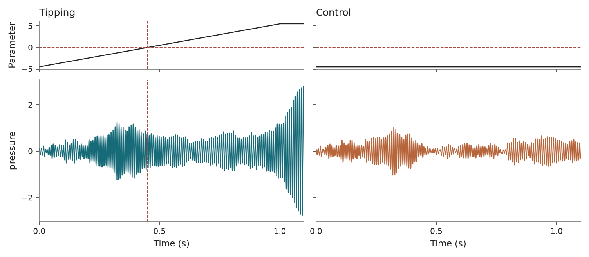

Thermoacoustic subcritical Hopf oscillator
==========================================

``Thermoacoustic`` implements the pressure oscillator in Bonciolini et al.
(2018), Eq. 3.7, with the coefficients from their numerical example.

Usage
-----

.. code-block:: python

   from tipbox.models import Thermoacoustic

   model = Thermoacoustic()
   result = model.make_trajectory(n=11001, dt_sample=0.0001, noise=1.0, seed=43)
   pressure = result.trajectory[:, 0]
   amplitude = result.trajectory[:, 2]

   control = model.make_trajectory(n=11001, dt_sample=0.0001, noise=1.0, seed=43, null_simulation=True)

   Pressure under tipping and control forcing. Dashed lines mark the linear Hopf reference.

Pressure equation
-----------------

Let :math:`\omega_0=2\pi f_0` and :math:`\nu(t)` be the linear growth rate.
With standard white noise :math:`\xi`, the oscillator is

.. math::

   \ddot p+\omega_0^2p=
   [2\nu(t)+\kappa p^2-\mu p^4]\dot p
   +\eta\sqrt{\Gamma}\,\xi(t),

where :math:`\kappa,\mu>0` and :math:`\eta` is the ``noise`` argument.
The positive quadratic nonlinear damping term destabilizes intermediate
amplitudes and the negative quartic term saturates large oscillations.
Pressure is in the numerical model's units; no conversion to measured
microphone pascals is assumed.

For numerical conditioning, the state is :math:`(p,y)` with
:math:`y=\dot p/\omega_0`:

.. math::

   dp &= \omega_0y\,dt,\\
   dy &= [-\omega_0p+(2\nu+\kappa p^2-\mu p^4)y]\,dt
          +\frac{\eta\sqrt{\Gamma}}{\omega_0}\,dW_t.

The three observed columns are pressure, scaled velocity, and the instantaneous
phase-plane amplitude :math:`\sqrt{p^2+y^2}`. The last quantity uses the
simulated velocity and is not a Hilbert envelope estimated from pressure alone.
``initial_state`` must follow [pressure, scaled_velocity].

Noise, numerical method, and forcing
------------------------------------

The model uses RK4 for deterministic drift with forcing evaluated at actual
step endpoints and midpoints. Independent additive noise is applied to
:math:`y` at each integration-step end, with standard deviation
:math:`\eta\sqrt{\Gamma dt}/\omega_0`. ``result.sigma`` reports this scale.
``noise=1`` recovers the published numerical noise intensity :math:`\Gamma=10^6`;
the shared default ``noise=0.01`` gives effective intensity 100. Initial
conditions are fixed and illustrative. The source's stationary-PDF initial
sampling is not reproduced by this default.

Integration defaults to ``dt=0.0001`` seconds and output spacing to
``dt_sample=0.0005`` seconds (2 kHz). Output spacing must be an integer multiple
of the integration step. Reduce ``dt`` and check convergence when changing
frequency, coefficients, or noise; no stabilizing amplitude clip is applied.

Forced growth increases linearly from ``nu_start`` to ``nu_end`` over the
simulated duration divided by ``param_end_multiplier`` (default 1.1), then
remains capped. With the default 1.1-second duration, the ramp lasts one second
and its slope is 10 s^-2, as in a source numerical example. Null forcing holds
``nu_null`` constant. A custom forcing callable can define a different schedule.

Hopf, cycle fold, and event definitions
---------------------------------------

The deterministic zero-pressure equilibrium loses linear stability at
:math:`\nu=0`. Averaging the noise-free oscillator gives

.. math::

   \dot A=A\left(\nu+\frac{\kappa}{8}A^2-\frac{\mu}{16}A^4\right).

Its cycle fold is at :math:`\nu_{\rm fold}=-\kappa^2/(16\mu)` (default -2 s^-1),
available as ``model.fold_parameter``. Between that fold and the Hopf point,
low- and high-amplitude states can coexist. The nonlinear signs and noise
convention follow the original pressure equation and its averaged amplitude equation.

The classifier detects forcing reaching the Hopf point, and its positive marker
is the first sample with :math:`\nu\ge0`. The null marker is the midpoint.
Neither marker estimates the observed jump: noise can trigger an earlier switch
and finite-rate forcing can delay growth after Hopf. A null value inside the
bistable range does not guarantee a low-amplitude state. The default null value
(-4.5 s^-1) is below the averaged fold.

Parameters and defaults
-----------------------

.. model-parameters:: b_thermoacoustic

Reference
---------

Bonciolini, Ebi, Boujo and Noiray (2018), *Experiments and modelling of
rate-dependent transition delay in a stochastic subcritical bifurcation*,
`Royal Society Open Science 5, 172078 <https://doi.org/10.1098/rsos.172078>`_,
Eq. 3.7 and Appendix A.2. The model parameters
:math:`f_0=120,\kappa=8,\mu=2,\Gamma=10^6` are from that numerical example;
they are not an identified fit to a particular microphone episode.
