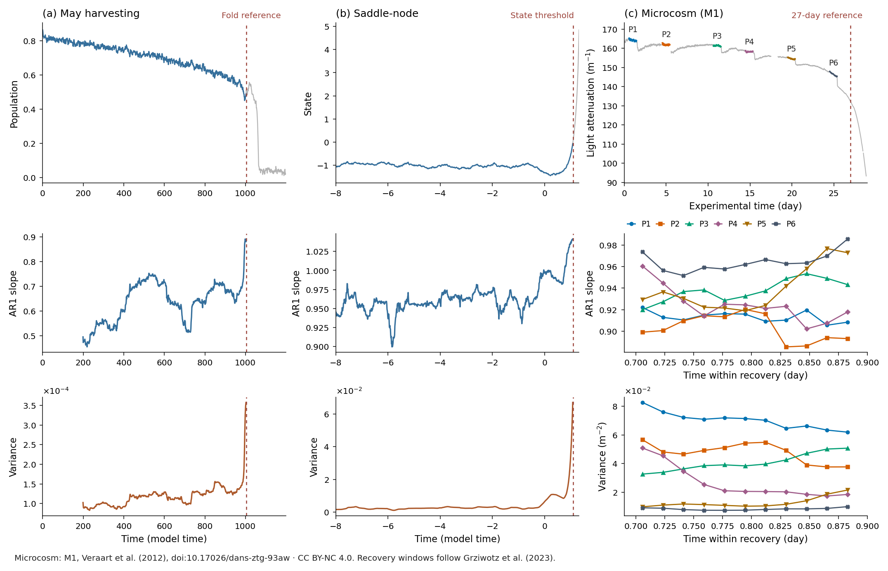

From a trajectory to a benchmark
================================

A changing time series can illustrate a transition. Evaluating a warning signal
needs a little more structure: a named observable, a reference event, and
independent tipping and control trajectories. This guide builds those pieces.
Each Python example includes its own imports.

Install TipBox
--------------

Use Python 3.10 or newer. From a terminal:

.. code-block:: bash

   git clone https://github.com/juannat7/tipbox.git
   cd tipbox
   pip install -e .

Simulate a population under harvesting
--------------------------------------

May's harvesting model combines population growth with a gradually increasing
harvesting rate. Its high-population equilibrium disappears at a fold. Start
with the model's documented coefficients and set the noise and seed explicitly:

.. code-block:: python

   from tipbox.models import MayHarvesting

   model = MayHarvesting()
   result = model.make_trajectory(1000, noise=1.0, seed=42)
   print(result.time.shape)        # (1000,)
   print(result.trajectory.shape)  # (1000, 1)
   print(model.get_parameters())

``result.trajectory[:, 0]`` is the observed population. ``n=1000`` includes the
initial sample. ``noise`` multiplies the configured diffusion amplitude; it is
not a universal standard deviation shared by all models. The
:doc:`harvesting reference <models/harvesting>` gives the equation, defaults,
and noise convention. :doc:`usage` covers custom coefficients, initial states,
forcing, integration steps, and output spacing.

Measure a signal before its reference
-------------------------------------

AR1 measures the lag-one regression slope within a window. Variance
measures their spread. Both may change as recovery slows near some
bifurcations. Use trailing windows and choose the analysis settings before
looking at evaluation labels.

.. code-block:: python

   from tipbox.models import MayHarvesting
   from tipbox.indicators import rolling_ar1, rolling_variance

   model = MayHarvesting()
   result = model.make_trajectory(1000, noise=1.0, seed=42)
   reference = model.locate_transition(
       result.trajectory, null_simulation=False,
       param_values=result.param_values, time=result.time,
   )
   if reference is None:
       raise ValueError("The forcing did not reach the model's reference.")
   time = result.time[:reference]
   signal = result.trajectory[:reference, 0]
   ar1 = rolling_ar1(signal, window=200, detrend="linear")
   variance = rolling_variance(signal, window=200, detrend="linear")

This example's forcing reaches the fold. For other configurations, a reference
can be absent; check ``reference is None`` before slicing or labeling. The
initial 199 indicator values are ``NaN`` because their windows are incomplete.
Linear detrending is fitted independently within each window. A fixed integer
window is appropriate for streaming; a fractional window depends on the total
record length. See :doc:`indicators` for all five classical statistics.

The figure puts three cases side by side. Harvesting uses a fold crossing.
The moving-equilibrium model illustrates rate-induced tipping: a state can fail
to track a rapidly moving stable equilibrium. Its reference is a state threshold.
The microcosm is observed data, analyzed as separate recoveries. These reference
rules have different meanings; AR1 and variance need not rise in every case.
Figure controls and the empirical CC BY-NC 4.0 attribution are in :doc:`figures`.

Compare independent trajectories
--------------------------------

A single transition cannot give a binary AUROC. Generate a small labeled batch
and reduce each trajectory's indicator to one Kendall trend score:

.. code-block:: python

   import matplotlib.pyplot as plt
   from tipbox.datasets import generate_dataset
   from tipbox.indicators import rolling_ar1, rolling_variance
   from tipbox.metrics import ensemble_roc, plot_roc
   from tipbox.models import MayHarvesting

   data = generate_dataset(
       MayHarvesting(), num_timesteps=300,
       n_tipping=5, n_null=5, n=1000,
       noise=1.0, lead_steps=1, seed=42,
   )
   print(data.observations.shape)  # (10, 300, 1)
   signals = data.observations[:, :, 0]
   indicators = {
       "AR1": [rolling_ar1(x, window=100, detrend="linear") for x in signals],
       "Variance": [rolling_variance(x, window=100, detrend="linear") for x in signals],
   }
   report = ensemble_roc(data.labels, indicators)
   print(report.curves["Variance"].auroc)
   print(report.curves["Variance"].n_valid)  # 10
   plot_roc(report)
   plt.show()

``n`` controls the full simulation; ``num_timesteps`` controls the retained
context. ``lead_steps=1`` ends the context one observation before its reference.
Rows are independent simulations, with null rows first. Their accepted seeds,
rejected attempts, references, and physical lead times are in ``data.metadata``.

Both score directions above are declared increasing. ``ensemble_roc`` does not
choose a sign to improve AUROC, and it reports finite and missing score counts.
These batches are conditioned on the model's outcomes; they do not estimate
natural tipping probabilities. See :doc:`benchmarks` for the complete contract.

Use an empirical recovery
-------------------------

The original microcosm deposit contains both chemostats, M1 and M2, and preserves
full-precision times. It downloads once into the user cache. The original data
are CC BY-NC 4.0; cite Veraart et al. (2012) and
`the DANS deposit <https://doi.org/10.17026/dans-ztg-93aw>`_.

.. code-block:: python

   import numpy as np
   from tipbox.datasets import load_microcosm_original
   from tipbox.indicators import rolling_variance

   record = load_microcosm_original()
   print(record.observations.shape)  # (7914, 2), columns M1 and M2
   recovery = record.observations[161:411, 0]
   variance = rolling_variance(recovery, window=200, step=5, detrend="linear")
   print(int(np.isfinite(variance).sum()))  # 11

Rows ``[161:411]`` are the published P1 analysis interval in this pinned M1
record. Keep recoveries separate: joining intervals creates artificial lagged
pairs across perturbations. With ``step=5``, skipped endpoints remain ``NaN``;
plot the finite estimates within each recovery to connect them. :doc:`datasets`
lists all six intervals, the five KEWS cases, missingness, source terms,
and offline controls.

Continue from here
------------------

* :doc:`api`: imports, input/output contracts, discovery, and returned objects.
* :doc:`models/index`: choose a model and inspect its equations and defaults.
* :doc:`figures`: reproduce the published gallery, indicators, and ROC panels.
* :doc:`sim_to_real`: Daphnia/TAC simulation components and the source-access boundary.
